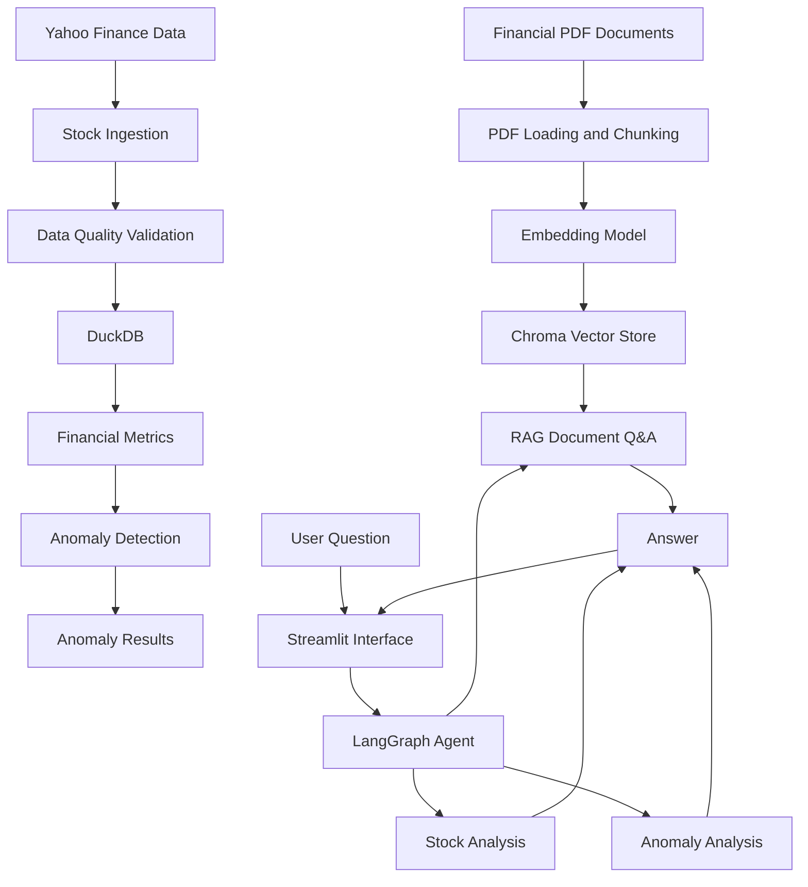

# AI-Powered Financial Intelligence Platform

An end-to-end financial data and AI application that combines stock-market data engineering, financial analytics, anomaly detection, and retrieval-augmented generation (RAG) in one interactive platform.

## Overview

Financial information is spread across market data and financial documents. This project brings these sources together so users can explore historical stock prices, identify unusual price movements, and ask questions about financial documents through an AI-powered interface.

The application uses a local language model for document question answering and a LangGraph workflow to route questions to the appropriate analysis tool.

## Key Features

- **Stock data ingestion:** Download historical daily stock prices using Yahoo Finance data through `yfinance`.
- **Data quality validation:** Check required columns, dates, missing values, duplicate records, and price consistency.
- **Analytical storage:** Store historical stock data in DuckDB.
- **Financial metrics:** Calculate daily returns, price changes, and 7-session and 30-session moving averages.
- **Anomaly detection:** Flag unusually large daily returns using rolling statistics and a z-score threshold.
- **Document Q&A with RAG:** Load financial PDFs, split documents into chunks, create embeddings, and retrieve relevant passages.
- **Local LLM integration:** Generate document-based answers using Ollama and the `qwen2.5:3b` model.
- **Agent workflow:** Use LangGraph to route questions to stock analysis, anomaly detection, or document question answering.
- **Interactive dashboard:** Use Streamlit and Plotly to display stock-price history and provide a chat interface.
- **Automated tests:** Use pytest to test pipeline outputs and anomaly-detection behavior.

## Architecture



## Technology Stack

| Area | Technologies |
|---|---|
| Language | Python |
| Data ingestion | yfinance, pandas |
| Analytical storage | DuckDB |
| Financial analytics | pandas, NumPy |
| Anomaly detection | Rolling statistics, z-scores |
| RAG and orchestration | LangChain, LangGraph |
| Embeddings and retrieval | Hugging Face Sentence Transformers, Chroma |
| Local language model | Ollama, Qwen 2.5 3B |
| User interface | Streamlit, Plotly |
| Testing | pytest |

## Project Structure

```text
AI-Powered-Financial/
├── data/
│   ├── raw/
│   ├── processed/
│   ├── chroma_db/
│   └── financial.duckdb
├── documents/
├── frontend/
│   └── app.py
├── src/
│   ├── ingestion/
│   │   ├── stock_ingestion.py
│   │   └── load_to_duckdb.py
│   ├── analysis/
│   │   ├── validate_data.py
│   │   ├── query_stock_data.py
│   │   ├── financial_metrics.py
│   │   └── anomaly_detection.py
│   ├── rag/
│   │   ├── ingest_documents.py
│   │   ├── retrieve_documents.py
│   │   └── answer_question.py
│   ├── agent/
│   │   ├── financial_tools.py
│   │   └── financial_agent.py
│   └── run_pipeline.py
├── tests/
│   ├── test_pipeline_outputs.py
│   └── test_anomaly_detection.py
├── requirements.txt
├── .gitignore
└── README.md
```

*Generated database files, vector indexes, and CSV outputs may be created when the project runs; they do not need to be committed to GitHub.*

## Prerequisites

- Python 3.11 or another Python version compatible with the installed dependencies.
- Git.
- Ollama installed locally.
- The `qwen2.5:3b` model downloaded through Ollama.
- An internet connection for downloading stock data and installing dependencies.

## Setup and Installation

### 1. Clone the repository

```bash
git clone https://github.com/YOUR_USERNAME/YOUR_REPOSITORY.git
cd YOUR_REPOSITORY
```

Replace the repository URL with your actual GitHub repository URL.

### 2. Create a virtual environment

Windows PowerShell:

```powershell
python -m venv venv
.\venv\Scripts\Activate.ps1
```

### 3. Install dependencies

```powershell
python -m pip install --upgrade pip
pip install -r requirements.txt
```

Ensure `requirements.txt` includes all packages used by the project, including the Streamlit, Plotly, LangChain integration, and Ollama dependencies.

### 4. Prepare the local language model

Install Ollama from its official website if it is not already installed, then run:

```powershell
ollama pull qwen2.5:3b
```

The local model must be available when asking questions that require LLM generation.

### 5. Run the financial data pipeline

From the project root:

```powershell
python -m src.run_pipeline
```

The pipeline downloads stock data, validates it, loads it into DuckDB, calculates financial metrics, and generates anomaly results.

### 6. Index financial documents

Place a suitable financial PDF in the `documents/` folder, then run:

```powershell
python -m src.rag.ingest_documents
```

Run document ingestion before asking questions about newly added PDFs.

### 7. Launch the web application

```powershell
streamlit run frontend/app.py
```

Open the local URL displayed by Streamlit.

### 8. Run the tests

```powershell
python -m pytest -v
```

The project currently includes five tests covering pipeline outputs and anomaly-detection behavior.

## Example Questions

- What is the average price of AAPL?
- Were there any unusual movements in AAPL?
- What financial risks are discussed in the report?

Available answers depend on the stock data and financial documents currently loaded into the application.

## Design Decisions

- **DuckDB:** Provides local analytical storage without requiring a separately managed database server.
- **Chroma:** Stores document embeddings locally for semantic retrieval.
- **Local LLM:** Allows document question answering without requiring a paid hosted-model API.
- **LangGraph:** Organizes the question-routing workflow into separate processing paths.
- **pytest:** Helps catch regressions in data outputs and anomaly-detection logic.

## Limitations

- The current stock ingestion workflow is configured for AAPL by default.
- Anomaly detection identifies statistical outliers; an outlier is not necessarily a genuine market event.
- Document answers depend on the quality of the indexed documents and retrieved context.
- The project currently runs locally; cloud deployment and production-scale operation are not claimed.
- The application is for informational and educational purposes, not investment advice.

## Future Improvements

Potential future work includes broader ticker coverage, scheduled ingestion, additional data-quality tests, and deployment. These are optional extensions rather than requirements for the current version.

## Disclaimer

This project is for educational and informational purposes only. It does not provide personalized financial or investment advice.

## Author

Rahul Kumar